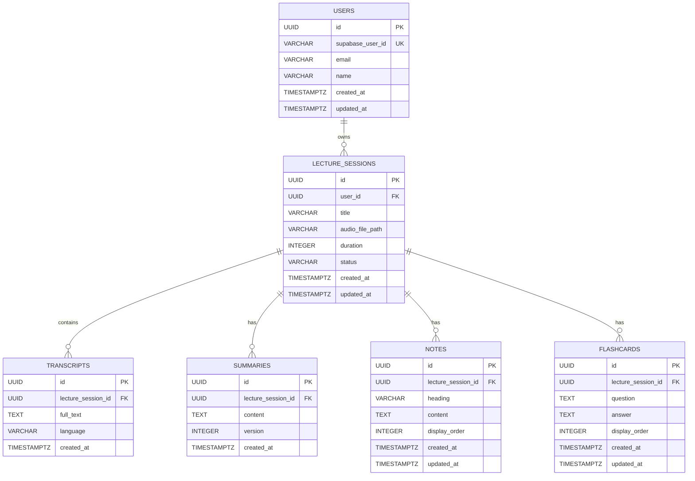

# AUDIQUE 2.0 – SYSTEM ARCHITECTURE

## 1. Overview
Audique 2.0 is a modern, AI-powered lecture transcription and intelligent study materials generation platform. It transforms spoken audio into searchable transcripts, structured notes, executive summaries, and interactive flashcards.

## 2. High-Level Architecture Diagram

```
                                  [ USER BROWSER ]
                                         |
                                         | HTTP / HTTPS
                                         v
                             +-----------------------+
                             |   NGINX REVERSE PROXY |
                             |   (Port 80 / 3000)    |
                             +-----------------------+
                                  /             \
                   Static Assets /               \ Proxy /api/*
                                v                 v
         +--------------------------+   +------------------------------------+
         |   REACT 19 FRONTEND      |   |   SPRING BOOT 3 (JAVA 21) BACKEND  |
         |   - Identical UI design  |   |   - Spring Web / Security / JPA    |
         |   - Centralized API svc  |   |   - Supabase JWT Signature Auth    |
         |   - Supabase Auth SDK    |   |   - Flyway DB Migrations           |
         +--------------------------+   +------------------------------------+
                                                    |            |
                           +------------------------+            +-------------------+
                           |                                                         |
                           v                                                         v
             +----------------------------+                            +----------------------------+
             |         POSTGRESQL         |                            |       EXTERNAL APIS        |
             |                            |                            |                            |
             | - users                    |                            | 1. Groq Cloud:             |
             | - lecture_sessions         |                            |    - Whisper (STT)         |
             | - transcripts              |                            |    - LLaMA (Summary, Notes,|
             | - summaries                |                            |      Flashcards JSON)      |
             | - notes                    |                            |                            |
             | - flashcards               |                            | 2. Supabase Cloud:         |
             |                            |                            |    - Storage (Audio files) |
             | (Docker PG or Supabase PG) |                            |    - Auth (JWKS validation)|
             +----------------------------+                            +----------------------------+
```

## 3. Component Responsibilities

### 3.1 React Frontend
- **Preserved Design System**: 100% visual fidelity maintained with dark/light theme gradient cards, animations, and typography.
- **Audio Capture**: Browser `MediaRecorder` API with waveform visualization and audio level simulation.
- **State & UI**: Centralized API service layer (`apiService.js`) handling token injection, refresh hydration, and optimistic updates.
- **Authentication Client**: Supabase Authentication for login and registration.

### 3.2 Spring Boot Backend
- **Layered Monolith Architecture**:
  - `controller`: REST endpoints, request validation, HTTP response negotiation.
  - `service`: Business orchestration, transactional boundaries, entity lifecycle.
  - `repository`: Spring Data JPA interfaces for PostgreSQL queries.
  - `entity`: JPA entity models with UUID primary keys and cascading rules.
  - `security`: Supabase JWT claim verification, stateless session management, per-user resource authorization.
  - `integration`: Non-blocking `WebClient` adapters for Groq Whisper/LLaMA and Supabase Storage.
  - `exception`: Centralized `@RestControllerAdvice` handling with consistent error payloads.

### 3.3 Database (PostgreSQL)
- Primary persistent storage for application data.
- Relational schema managed via Flyway versioned migrations (`V1__initial_schema.sql`).
- Supports both local Docker container and hosted Supabase PostgreSQL.

### 3.4 AI Services (Groq Cloud)
- **Speech-to-Text**: Groq Whisper (`whisper-large-v3-turbo`) for high-speed, accurate speech transcription.
- **Language Models**: Groq LLaMA (`llama-3.1-8b-instant`) utilizing structured JSON output mode for extracting notes and flashcards, and prompt engineering for executive summaries.

### 3.5 Supabase Integration
- **Auth**: User identities managed by Supabase, validated via HMAC-SHA256 JWT decoding in Spring Security.
- **Storage**: Audio files saved to bucket `audio-files`, referenced by URI in `lecture_sessions.audio_file_path`.

---

## 4. Database Design & Entity Relationship (ER) Diagram



---

## 5. Security & Multi-Tenancy Architecture
1. **Authentication**:
   - The user signs in via Supabase Auth on the frontend.
   - The access token (JWT) is sent in the `Authorization: Bearer <token>` header.
   - Spring Security decodes the JWT and extracts the `sub` claim (Supabase User UUID).
2. **Identity Mapping**:
   - `UserService.getOrCreateUser()` maps the Supabase UUID to an internal `User` entity.
3. **Data Isolation**:
   - Every lecture query filters by `userId`.
   - Update and delete operations on notes, flashcards, summaries, and transcripts verify that the parent lecture belongs to the authenticated user.
   - Attempts to access or mutate other users' resources result in an HTTP 403 Forbidden or HTTP 404 Not Found.

