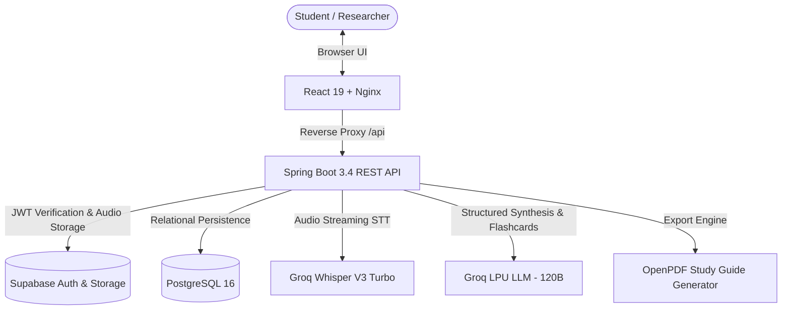

# Audique AI 🎙️🧠
### *AI-Powered Academic Lecture Intelligence & Study Materials Engine*

[](https://spring.io/projects/spring-boot)
[](https://openjdk.org/)
[](https://react.dev/)
[](https://groq.com/)
[](https://www.postgresql.org/)
[](https://www.docker.com/)
[](LICENSE)

Audique AI is an enterprise-grade full-stack web platform designed to transform spoken university lectures and classroom audio into structured academic assets in seconds. Utilizing ultra-fast Groq LPU inference, Audique transcribes audio, synthesizes multi-tier executive study guides, generates flashcards, and exports publication-grade formatted PDFs.

---

## 🌟 Key Features

### 🎙️ 1. Ultra-Fast Speech-to-Text
* Powered by **Groq Whisper Large V3 Turbo** (`whisper-large-v3-turbo`).
* Transcribes live audio recordings or uploads within 2–4 seconds.
* Paces transcripts into natural spoken paragraph blocks with realistic pacing timestamps (`00:00`, `00:45`, `01:30`) instead of fragmented one-sentence splices.

### 🧠 2. Publication-Grade Academic Synthesis
* Powered by Groq's flagship **`openai/gpt-oss-120b`** (or `openai/gpt-oss-20b`) reasoning engine.
* **Three-Tier Structure**:
  1. **Executive Overview**: High-level thesis and intellectual significance in articulate academic prose.
  2. **Core Conceptual Pillars**: Visual concept cards with highlighted key terminology.
  3. **Essential Takeaways**: High-impact conclusions formatted for exam mastery.

### 🎴 3. Interactive Revision Flashcards
* Automated JSON-mode extraction that creates genuine question-and-answer study pairs.
* Front/back 3D flip card animations in React 19.
* Built-in sanitization preventing repetitive header placeholders and a 1-click regenerate action.

### 📄 4. Publication-Ready PDF Export
* Built with **OpenPDF 2.0.3**.
* Features a dark slate `#0F172A` executive header banner with cyan branding accents.
* Left-bordered colored callout cards (`#F8FAFC`) for core concepts.
* Bulleted takeaway lists with bold inline markdown parsing—no raw markdown tags (`###`, `**`).

### 🛡️ 5. Modern Architecture & Security
* **Backend**: Java 21 LTS with Spring Boot 3.4, Hibernate JPA, and Flyway automated schema migrations.
* **Authentication**: Supabase Auth with Spring Security OAuth2 JWT cryptographic signature verification.
* **Storage**: Supabase Storage with signed path retention.
* **Orchestration**: Production-ready multi-stage Docker Compose setup.

---

## 🏗️ Architecture



---

## 🛠️ Tech Stack

| Layer | Technologies |
| :--- | :--- |
| **Frontend** | React 19, Tailwind CSS, Framer Motion, Lucide Icons, Nginx |
| **Backend** | Java 21 (Temurin), Spring Boot 3.4, Spring Security, Spring Data JPA, Flyway |
| **AI Inference** | Groq Cloud LPU (`whisper-large-v3-turbo`, `openai/gpt-oss-120b`) |
| **Database** | PostgreSQL 16 (Relational Schema with connection pooling via HikariCP) |
| **PDF Generation**| OpenPDF 2.0.3 |
| **Auth & Cloud** | Supabase Auth (JWKS asymmetric JWT) & Supabase Storage |
| **DevOps** | Docker, Docker Compose (Multi-stage container builds) |

---

## ⚡ Quick Start with Docker

### Prerequisites
* [Docker Desktop](https://www.docker.com/products/docker-desktop/) (Running)
* A free [Groq API Key](https://console.groq.com/keys)

### 1. Clone the Repository
```bash
git clone https://github.com/abhishekkumar3513/audique-ai.git
cd audique-ai
```

### 2. Configure Environment Variables
Copy `.env.example` to `.env`:
```bash
cp .env.example .env
```
Ensure your `.env` contains your Groq API key:
```env
GROQ_API_KEY=gsk_your_groq_api_key_here
GROQ_LLM_MODEL=openai/gpt-oss-120b
GROQ_WHISPER_MODEL=whisper-large-v3-turbo
```

### 3. Launch with Docker Compose
```bash
docker compose up --build -d
```

### 4. Access the Application
* **Frontend Web Dashboard**: [http://localhost:3000](http://localhost:3000)
* **Backend API Base**: [http://localhost:8080](http://localhost:8080)
* **Interactive Swagger UI**: [http://localhost:8080/swagger-ui.html](http://localhost:8080/swagger-ui.html)
* **Actuator Health Check**: [http://localhost:8080/actuator/health](http://localhost:8080/actuator/health)

---

## 📁 Repository Structure

```
audique-ai/
├── docker-compose.yml              # Container orchestration (Frontend, Backend, DB)
├── .env.example                    # Template for environment variables
├── AUDIQUE_ARCHITECTURE.md         # Detailed architectural documentation
├── AUDIQUE_DEPLOYMENT.md           # Production deployment guide
├── AUDIQUE_TESTING_REPORT.md       # Comprehensive testing & QA logs
│
├── frontend/                       # React 19 UI
│   ├── Dockerfile                  # Multi-stage React build with Nginx serving
│   ├── nginx.conf                  # Nginx reverse proxy configuration
│   ├── package.json
│   └── src/
│       ├── services/apiService.js  # Unified API client
│       ├── figma-ui/components/    # Modernized dashboard views (Summary, Notes, Flashcards)
│       └── App.js                  # Main application state & session lifecycle
│
└── backend-spring/                 # Spring Boot 3.4 Backend
    ├── pom.xml                     # Maven project configuration
    ├── Dockerfile                  # Multi-stage Maven build + Java 21 JRE runtime
    └── src/main/
        ├── java/com/audique/
        │   ├── config/             # Security, CORS, Groq & Storage configs
        │   ├── controller/         # REST endpoints (Lectures, Notes, Flashcards, PDF)
        │   ├── entity/             # JPA Entities (LectureSession, Note, Summary, Flashcard)
        │   ├── repository/         # Spring Data JPA repositories
        │   ├── service/            # Core business logic (PdfService, FlashcardService, etc.)
        │   └── integration/        # GroqClient (Whisper + LLM) & SupabaseStorageClient
        └── resources/
            ├── application.yml     # Application configuration
            └── db/migration/       # Flyway SQL migrations
```

---

## 📡 REST API Reference

| Method | Endpoint | Description |
| :--- | :--- | :--- |
| `GET` | `/actuator/health` | Service health status |
| `POST` | `/transcribe` | Transcribe audio stream with Groq Whisper |
| `POST` | `/summarize` | Generate 3-tier academic summary from text |
| `POST` | `/flashcards` | Generate revision flashcards from text |
| `POST` | `/download-pdf` | Export styled PDF study guide |
| `POST` | `/api/lectures` | Create authenticated lecture session |
| `GET` | `/api/lectures/{id}` | Retrieve complete lecture data (Notes, Cards, Summary) |
| `POST` | `/api/lectures/{id}/notes/generate` | Extract organized concept notes |
| `POST` | `/api/lectures/{id}/flashcards/generate` | Generate flashcard set |
| `GET` | `/api/lectures/{id}/export/pdf` | Export lecture study guide to PDF |

---

## 🔐 Security & Multi-Tenancy

* **Zero-Secrets Policy**: Sensitive files (`.env`, database credentials) are excluded from git history.
* **JWT Verification**: Validates Supabase bearer tokens against Supabase's JWKS endpoint before granting access to authenticated endpoints.
* **Per-User Isolation**: Queries strictly isolate lecture sessions by the authenticated user's Supabase UUID.

---

## 📄 License
This project is licensed under the MIT License - see the [LICENSE](LICENSE) file for details.
